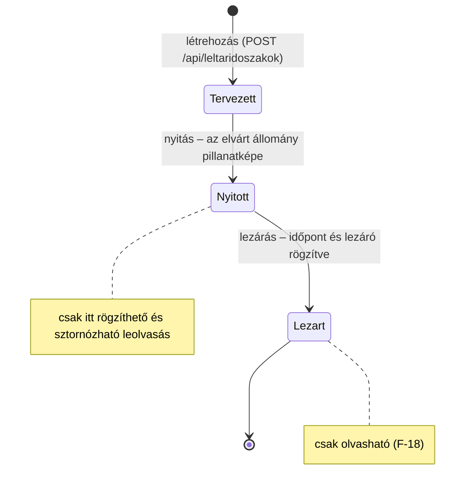
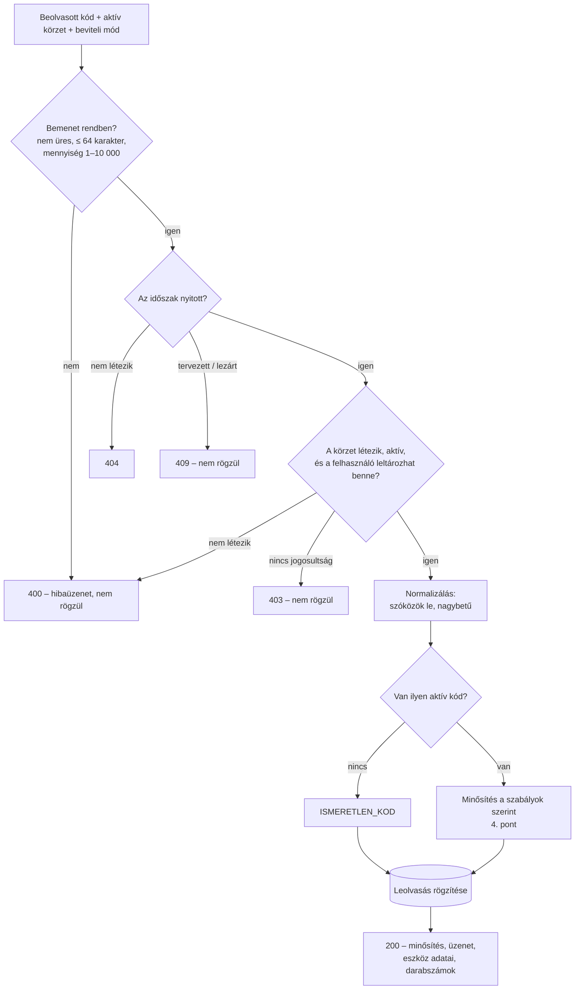

# A leltározás alapfunkciói – szerveroldal

**Felelős:** Horváth Máté · **Állapot:** a 6. alkalomra elkészült, tesztelt változat

A 6. alkalom elvárása a leltározás alapfolyamata: leltárkörzet kiválasztása, vonalkód beolvasása (olvasóval és
olvasó nélküli szimulációval), az érvényes és érvénytelen kódok kezelése, az azonosítás többféle kód alapján, és a
leolvasás mentése. Ez a leírás a szerveroldali logikát mutatja be: a leltáridőszak és a leolvasás állapotait, a
minősítés szabályait, a hibás eseteket, a végpontokat és a teszteket. A leltározó képernyő (kliens) Bárkányi Máté
feladata, ehhez a 9. pont adja meg a szerződést.

Ez a dokumentum pótolja a 3. alkalomról elmaradt **leltározási folyamat tervét** is
(`04_alkalom/03_Teendok_az_5_alkalomig.md`, P1).

## 1. Mi készült el?

| Elvárás (kiírás, 6. alkalom) | Megvalósítás |
|---|---|
| Leltárkörzet kiválasztása | `GET /api/leltarkorzetek` – az aktív körzetek, jelölve, hogy a felhasználó melyikben leltározhat |
| Leltáridőszak kiválasztása | `GET /api/leltaridoszakok?statusz=Nyitott`; nyitás és lezárás végpontok, nyitáskor pillanatkép (D-003) |
| Vonalkód beolvasása | `POST /api/leltaridoszakok/{id}/leolvasasok` – a kód, az aktív körzet és a beviteli mód alapján |
| Szimuláció olvasó nélkül | `GET /api/leltaridoszakok/{id}/demokod` – érvényes vagy érvénytelen tesztkód; a beolvasás `Demo` módként rögzül |
| Érvényes / érvénytelen kód | Minden kód leolvasásként rögzül; az ismeretlen kód `ISMERETLEN_KOD` minősítést kap (F-15) |
| Többféle eszközkód | Azonosítás bármely aktív kód alapján, normalizálva (D-012); a válasz megmondja, melyik kódtípus illeszkedett |
| Leolvasás mentése | `Leolvasas` esemény időszakkal, körzettel, felhasználóval, időbélyeggel, beviteli móddal (D-002) |
| *(előre a 7. alkalomra)* | Ismételt beolvasás, többlet, más körzet minősítése; sztornó indoklással; leolvasásnapló |
| *(az 5. alkalomról)* | Törzsadat-végpontok, eszközlista-szűrés, láthatóság szerepkör szerint – lásd [02_Torzsadatok_szures_jogosultsag.md](02_Torzsadatok_szures_jogosultsag.md) |

## 2. A leltáridőszak állapotai



- **Tervezett:** az időszak létezik, de még nem lehet beolvasni. Így a leltárfelelős előre felveheti az éves leltárt.
- **Nyitás:** a szerver egy lépésben rögzíti az **elvárt állományt** (`ElvartTetel`): minden nem megszűnt állapotú
  eszközt a nyitás pillanatában érvényes körzetével és elvárt mennyiségével (D-030). A későbbi összehasonlítás ehhez
  viszonyít, így a forrásadatok utólagos változása nem írja át egy korábbi leltár eredményét (D-003).
- **Lezárás:** az időszak véglegessé válik; a lezárás időpontja és a lezáró felhasználó rögzül. Lezárt időszakba
  nem lehet beolvasni, és leolvasást sem lehet sztornózni.
- Egyszerre több időszak is lehet nyitva (pl. éves és rendkívüli leltár, F-17); a beolvasó képernyőn mindig egy van
  kiválasztva, a kérés útvonala tartalmazza az azonosítóját.
- Visszafelé nincs átmenet: lezárt időszak nem nyitható újra, nyitott nem állítható vissza tervezettre.

## 3. Egy beolvasás feldolgozása



A lényeg: **ami bemenetként érvényes, az mindig rögzül**, akkor is, ha ismeretlen vagy problémás (más körzet,
selejtezett, ismételt). A hibás esetek (4xx) a kérést magát utasítják el – ilyenkor semmi nem kerül az adatbázisba.

### 3.1 Azonosítás többféle kód alapján

Egy eszközhöz tetszőleges számú, típussal jelölt kód tartozhat (SAP szám, leltári szám 1–2, gyártási szám, belső
vonalkód – F-06). A szerver a beolvasott kódot normalizálja (vezető és záró szóközök, tabulátor és sorvége le,
nagybetűs alak – F-08), és az `EszkozKod.ErtekNorm` oszlopban keresi, amelyet az adatbázis ugyanezzel a szabállyal
számol (D-012). Csak az **aktív** kódok azonosítanak: egy inaktivált (pl. lecserélt) kód beolvasása ismeretlen kódként
rögzül.

Kódütközés nem fordulhat elő: az aktív kódok normalizált értékére szűrt egyedi index van, ezért egy kód legfeljebb
egy eszközt azonosít. Az eredetileg tervezett választóablak (UC-06, 5b) így nem szükséges – az ütközést már az
import kiszűri (F-07).

A válasz `eszkoz.kodTipus` mezője megmondja, melyik kódtípus illeszkedett, így a leltározó látja, ha például a
gyártási számot olvasta be az SAP-matrica helyett.

## 4. A minősítés szabályai

A szabályokat a szerver **ebben a sorrendben** vizsgálja; az első teljesülő adja a minősítést (D-027).

| # | Minősítés | Feltétel | Beleszámít a darabszámba? | Visszajelzés a kliensen (UC-06) |
|---|---|---|---|---|
| – | `ISMERETLEN_KOD` | Nincs ilyen aktív kód | – (nincs eszköz) | piros |
| 1 | `ISMETELT` | Egyedi eszköz (elvárt = 1), amelyet ebben az időszakban már beolvastak | **nem** (F-12, D-025) | narancs |
| 2 | `NEM_AKTIV` | Az eszköz állapota megszűnt (selejtezett, elveszett, ellopott, átadva) | igen | figyelmeztetés |
| 3 | `MAS_KORZET` | Az eszköz elvárt körzete nem az aktív körzet | igen (D-025) | sárga |
| 4 | `TOBBLET` | Az eddigi és a mostani mennyiség együtt meghaladja az elvártat | igen | figyelmeztetés |
| 5 | `OK` | Egyik sem | igen | zöld |

- Az **elvárt körzet és mennyiség** a nyitáskori pillanatképből jön; ha az eszköz a nyitás után került a rendszerbe,
  a jelenlegi törzsadatból.
- Az **eddig beolvasott** mennyiség a nem sztornózott és nem `ISMETELT` leolvasások összege (D-025).
- Az `ISMETELT` azért áll elöl, hogy egy már megszámolt egyedi eszköz ne számítson kétszer akkor sem, ha más
  körzetben vagy selejtezettként került elő – a második beolvasás így is rögzül, csak nem növeli a darabszámot.
- A `MAS_KORZET` megelőzi a `TOBBLET`-et: ha egy mennyiséges eszköz más körzetben bukkan fel, az eltérő hely a
  fontosabb információ.
- A minősítés egy tiszta, mellékhatás nélküli függvény (`BeolvasasSzolgaltatas.Minosit`), ezért közvetlenül,
  adatbázis nélkül is tesztelhető.

### 4.1 Példa válaszok

```http
POST /api/leltaridoszakok/3/leolvasasok
Authorization: Bearer eyJhbGciOi...
Content-Type: application/json

{ "kod": "L-2025-0001", "aktivKorzetId": 1, "beviteliMod": "Olvaso" }
```

```json
{
  "leolvasasId": 6077,
  "minosites": "Ok",
  "uzenet": "Rendben: Asztali számítógép Dell OptiPlex 7010 (1/1 db).",
  "eszkoz": { "id": 1, "megnevezes": "Asztali számítógép Dell OptiPlex 7010", "kodTipus": "Leltári szám 1",
              "leltarkorzetKod": "MIK-A", "leltarkorzetNev": "Mérnöki Kar – A épület", "allapot": "aktív",
              "mennyisegiEgyseg": "db" },
  "elvartMennyiseg": 1,
  "beolvasottMennyiseg": 1,
  "korabbiBeolvasas": null
}
```

Ugyanennek az eszköznek a második beolvasása `"minosites": "Ismetelt"`, `"beolvasottMennyiseg": 1` és kitöltött
`"korabbiBeolvasas"` (az első beolvasás UTC időpontja) értékkel tér vissza; a kliens ebből írja ki: *„Már beolvasva:
ma 10:42”*.

| Eset | `minosites` | `uzenet` (példa) |
|---|---|---|
| Ismeretlen kód | `IsmeretlenKod` | Ismeretlen kód: XYZ-NINCS. A leolvasás rögzítve, később kivizsgálható. |
| Más körzet | `MasKorzet` | Az eszköz a(z) GTK-G – Gazdaságtudományi Kar – G épület körzetbe tartozik: … |
| Selejtezett eszköz | `NemAktiv` | Nem aktív eszköz került elő (selejtezett): Irodai forgószék. … |
| 30 db-os székkészlet, 100 beolvasva | `Tobblet` | Többlet: Tantermi székkészlet – elvárt 30 db, beolvasva 100 db. |

A felsorolások a JSON-ban **névvel** utaznak (`"Ok"`, `"MasKorzet"`), nem sorszámmal (D-028).

## 5. Hibás és rendkívüli esetek

| Eset | Válasz | Rögzül? | Indoklás |
|---|---|---|---|
| Üres vagy csak szóközből álló kód | 400 | nem | Olvasóhiba vagy véletlen Enter; nincs mit rögzíteni |
| 64 karakternél hosszabb kód | 400 | nem | Az oszlop hossza; valószínűleg több kód egybeolvasva |
| Mennyiség < 1 vagy > 10 000 | 400 | nem | Elgépelés elleni védelem |
| Ismeretlen beviteli mód | 400 | nem | Csak a felsorolt módok engedettek |
| Nem létező vagy inaktív körzet | 400 | nem | A kliens csak a listából választhat |
| Nem létező időszak | 404 | nem | |
| Még nem nyitott (tervezett) időszak | 409 | nem | A pillanatkép még nem készült el |
| Lezárt időszak | 409 | nem | Lezárt leltár csak olvasható (F-18) |
| A leltározónak nincs joga a körzethez | 403 | nem | Jogosultsági mátrix |
| Megtekintő próbál beolvasni | 403 | nem | Szerepkör |
| Ismeretlen kód | 200 | **igen** | F-15 – a nyilvántartásból hiányzó eszközök feltárása |
| Inaktivált (régi) kód | 200 | **igen**, ismeretlenként | Csak aktív kód azonosít |
| Más körzet eszköze | 200 | **igen** | F-14 – megerősítés nélkül, jelölve |
| Egyedi eszköz ismételt beolvasása | 200 | **igen**, darabszám nélkül | F-12 |
| Mennyiséges eszköz elvárt felett | 200 | **igen** | F-13 – többlet, nem utasítjuk el |
| Selejtezett eszköz előkerül | 200 | **igen** | UC-06 6d – a leltárfelelős dönt |

Minden 4xx válasz Problem Details formátumú, a `detail` mezőben magyar, a felhasználónak megjeleníthető üzenettel
és `traceId` azonosítóval (D-018, D-029).

## 6. Sztornó

A leolvasás nem törölhető, csak **indoklással sztornózható** (F-11, UC-08): `POST /api/leolvasasok/{id}/sztorno`
`{ "indoklas": "..." }` → 204.

| Szabály | Hiba |
|---|---|
| Az indoklás kötelező, legfeljebb 500 karakter | 400 |
| A leltározó csak a saját leolvasását sztornózhatja; a leltárfelelős és az admin bárkiét | 403 |
| Csak nyitott időszakban | 409 |
| Már sztornózott leolvasás nem sztornózható újra | 409 |
| Nem létező leolvasás | 404 |

A sztornózott sor megmarad (ki, mikor, miért sztornózta), de a darabszámba és az ismétlésvizsgálatba nem számít: egy
tévesen beolvasott eszköz sztornó után újra beolvasva ismét `OK` lesz.

## 7. Végpontok

| Módszer | Útvonal | Szerepkör | Válasz |
|---|---|---|---|
| GET | `/api/leltarkorzetek` | bármely bejelentkezett | `LeltarkorzetAdat[]` – `leltarozhato` jelzővel |
| GET | `/api/kodtipusok` | bármely bejelentkezett | `KodTipusAdat[]` |
| GET | `/api/leltaridoszakok?statusz=` | bármely bejelentkezett | `LeltarIdoszakAdat[]`, legújabb elöl |
| GET | `/api/leltaridoszakok/{id}` | bármely bejelentkezett | `LeltarIdoszakAdat` (elvárt tételek száma is) |
| POST | `/api/leltaridoszakok` | Admin, Leltárfelelős | 201 `LeltarIdoszakAdat` (tervezett) |
| POST | `/api/leltaridoszakok/{id}/nyitas` | Admin, Leltárfelelős | `LeltarIdoszakAdat` – pillanatkép elkészült |
| POST | `/api/leltaridoszakok/{id}/lezaras` | Admin, Leltárfelelős | `LeltarIdoszakAdat` |
| POST | `/api/leltaridoszakok/{id}/leolvasasok` | Admin, Leltárfelelős, Leltározó¹ | `BeolvasasEredmeny` |
| GET | `/api/leltaridoszakok/{id}/leolvasasok?leltarkorzetId=&csakSajat=&sztornozottakkalEgyutt=&oldal=&oldalMeret=` | Admin, Leltárfelelős, Leltározó¹ | `LapozottLista<LeolvasasListaElem>`, legújabb elöl |
| GET | `/api/leltaridoszakok/{id}/demokod?leltarkorzetId=&ervenyes=` | Admin, Leltárfelelős, Leltározó | `DemoKod` |
| POST | `/api/leolvasasok/{id}/sztorno` | Admin, Leltárfelelős, Leltározó² | 204 |

¹ A leltározó csak a hozzá rendelt körzetekben (`FelhasznaloLeltarkorzet`) olvashat be, és csak ezek leolvasásait látja.
² A leltározó csak a saját leolvasását.

Az útvonalak a `Kozos` projekt `ApiUtvonalak` osztályában is szerepelnek (pl. `ApiUtvonalak.IdoszakLeolvasasai(id)`),
így a kliens nem gépel be útvonalat.

### 7.1 Szimuláció vonalkódolvasó nélkül

A kiírás szerint a beolvasásnak olvasó nélkül is bemutathatónak kell lennie. A szerver ehhez tesztkódot ad:

- `ervenyes=true` (alapértelmezés): a kiválasztott körzet egy **még be nem olvasott**, nem megszűnt eszközének egyik
  aktív kódja; ha már mindent beolvastak, bármelyik eszközé.
- `ervenyes=false`: `DEMO-XXXXXX` alakú kód, amelyről a szerver ellenőrzi, hogy egyetlen eszközhöz sem tartozik.

A kliens a kapott kódot ugyanazon a végponton küldi be, mint egy valódi beolvasást, `"beviteliMod": "Demo"` értékkel.
Így a demó beolvasások ugyanazt a logikát járják végig, mégis utólag kiszűrhetők. A kódot a kliens a beolvasó
mezőbe is beírhatja (Ctrl+Shift+R / Ctrl+Shift+E, UC-06 5c), a beillesztett kódot pedig `Beillesztes` módként küldi.

## 8. Jogosultság

A 4. alkalomban rögzített jogosultsági mátrix (`04_alkalom/01_Szerver_PoC.md`, 4.1) leltározásra vonatkozó sorai
most kerültek a végpontokra:

- **Szerepkör:** `[Authorize(Roles = ...)]` a `Jogosultsagok` osztály szerepkör-csoportjaival
  (`LeltarKezeles` = Admin + Leltárfelelős, `Beolvasas` = Admin + Leltárfelelős + Leltározó).
- **Körzet:** a `KorzetJogosultsag` szolgáltatás dönti el, hogy a felhasználó leltározhat-e egy körzetben. Az admin
  és a leltárfelelős mindenhol, a leltározó csak a hozzá rendelt körzetekben, a megtekintő sehol. A körzetválasztó
  ugyanezt a szabályt használja, így a kliens csak engedélyezett körzetet kínál fel.

## 9. Mit kap a kliens? (Bárkányi Máté)

| A leltározó képernyő eleme | Hívás | Megjegyzés |
|---|---|---|
| Időszakválasztó | `GET /api/leltaridoszakok?statusz=Nyitott` | Ha egy van, automatikusan kiválasztható |
| Körzetválasztó | `GET /api/leltarkorzetek` | A `leltarozhato = false` elemek letiltva |
| Beolvasó mező | `POST .../leolvasasok` | Az olvasó Entert küld (F-09); a fókusz a mezőben marad |
| Visszajelzés | a válasz `minosites` + `uzenet` | Szín a 4. pont táblázata szerint; az üzenet kész szöveg |
| Utolsó beolvasások | `GET .../leolvasasok?csakSajat=true&oldalMeret=20` | Legújabb elöl |
| Visszavonás | `POST /api/leolvasasok/{id}/sztorno` | Indoklás bekérése |
| Demó mód | `GET .../demokod` + `POST .../leolvasasok` `Demo` móddal | Olvasó nélküli bemutatóhoz |

Minden típus (`BeolvasasKeres`, `BeolvasasEredmeny`, `Minosites`, …) a `Kozos` projektben van, a kliens közvetlenül
használhatja. A hibák egységesen Problem Details formátumban érkeznek; a `detail` mező megjeleníthető.

## 10. Tesztek

`tests/Szerver.Tesztek/LeltarozasTesztek.cs` – a szerver a valódi HTTP-csővezetékkel indul, memóriabeli adatbázissal.
A `LeltarGyar` a 4. alkalom tesztadatait kiegészíti egy 3 db-os székkészlettel, egy selejtezett eszközzel, egy
inaktivált kóddal, valamint leltárfelelős, körzethez rendelt leltározó és megtekintő felhasználóval. Minden teszt saját
leltáridőszakot nyit, így a tesztek nem zavarják egymást.

| Terület | Tesztek |
|---|---|
| Minősítési szabályok (egységteszt, 9 eset) | `Minosites_elsobbsegi_sorrendje` |
| Leltáridőszak | nyitás pillanatképpel, újranyitás 409, hibás dátum 400, szerepkör 403 (2 eset), szűrés állapotra |
| Körzetválasztás | jogosultság jelzése, kódtípus-lista |
| Beolvasás | elsődleges és másodlagos kód, normalizálás, ismeretlen és inaktivált kód (2 eset), más körzet, ismételt, többlet, selejtezett, szöveges felsorolás a JSON-ban |
| Hibás esetek | üres kód (2 eset), túl hosszú kód és rossz mennyiség, nem létező körzet és időszak, tervezett időszak 409, lezárt időszak 409 |
| Jogosultság | körzetjogosultság, körzet nélküli leltározó, megtekintő |
| Sztornó | újrabeolvasás sztornó után, a sztornó szabályai (5 eset egy tesztben), leolvasásnapló láthatósága |
| Szimuláció | érvényes és érvénytelen demókód |

Eredmény: a leltározási tesztek mind sikeresek; a teljes tesztkészlet **85/85**, a fordítás figyelmeztetés nélküli.

**Kipróbálás SQL Serveren.** Az in-memory adatbázis nem ellenőrzi, hogy a lekérdezések lefordíthatók-e SQL-re,
ezért a szervert a `db/demoadatok.sql` adataival feltöltött SQL Server Express adatbázison is végigpróbáltuk: időszak
nyitása (229 elvárt tétel), mind a hat minősítés, demókód, jogosulatlan körzet (403), lezárt időszak (409), sztornó és
lezárás. A leolvasások a CHECK megszorításoknak megfelelően kerültek az adatbázisba.

## 11. Javítás a 4. alkalom kódjában

A kipróbálás közben derült ki, hogy a `Program.cs` az `appsettings.Local.json`-t a környezeti változók **után**
töltötte be, így az felülírta őket – ellentétben a D-017-ben rögzített sorrenddel. Emiatt egy
`ConnectionStrings__Leltar` környezeti változó (pl. egy külön teszt-adatbázishoz) hatástalan volt, és a `dotnet ef
database update` a helyi fájlban megadott adatbázist migrálta. Javítva: a helyi fájl után a környezeti változók és a
parancssori argumentumok újra betöltődnek, így a sorrend a dokumentáltnak megfelelő.

## 12. Ismert korlátok és a 7. alkalom teendői

| Téma | Jelenlegi állapot | Terv |
|---|---|---|
| Egyidejű beolvasás | Ha két leltározó ugyanabban a pillanatban olvassa be ugyanazt az egyedi eszközt, mindkettő `OK` lehet | Gyakorlatban ritka (egy fizikai eszköz egy helyen van); a 7. alkalomnál az összesítés a sorrendből számolja a darabszámot, vagy zárolással oldjuk meg |
| Sztornó után megmaradó ismétlés | Ha az első (számított) leolvasást sztornózzák, a második `ISMETELT` sor nem lép a helyébe | A 7. alkalom darabszám-nézete ezt kezeli; addig újrabeolvasással javítható |
| Helyiség | A `helyisegId` opcionális, ellenőrzött, de helytörténet még nem készül belőle (UC-06 6e) | 8. alkalom (C, A) |
| Kiegészítők | A fő eszköz beolvasásakor még nem jelöljük feltételezetten megtaláltnak (F-20) | 8. alkalom |
| Pillanatkép bővítése | A nyitás után felvett eszköz a jelenlegi törzsadat alapján minősül, de nem kerül be az elvárt tételek közé | Utólagos bővítés végpont (`Utolagos` felvételi ok) a 7. alkalomra |
| Rendkívüli leltár körzetre szűkítve | A nyitás a teljes állományról készít pillanatképet | Ha kell, a nyitás kérésében körzetlista |
| Audit napló | A műveletek a saját táblájukban követhetők (ki, mikor), az `AuditNaplo` még üres | 10. alkalom (C) |
