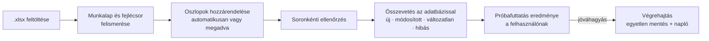

# Excel-import: a forrásadatok betöltése

**Felelős:** Kiss Barnabás · **Állapot:** a szolgáltatás és a tesztek elkészültek; a végpontok Horváth Máté feladata

Az 5. alkalom fő elvárása (*„Excel forrásállomány feldolgozása, adatimport”*) pótlása, a
[`03_alkalom/04_Excel_lekepezes.md`](../03_alkalom/04_Excel_lekepezes.md) terve alapján. Döntések: D-031–D-035.

## 1. Mi készült el?

| Rész | Hol | Mit csinál |
|---|---|---|
| Közös típusok | `src/Kozos/Import/ImportAdatok.cs` | Beállítások, a próbafuttatás és az import eredménye – a kliens is ezeket kapja |
| Excel-olvasó | `src/Szerver/Szolgaltatasok/Import/ExcelOlvaso.cs` | Munkalap és fejlécsor felismerése, oszlop-hozzárendelés, cellák beolvasása (ClosedXML) |
| Értelmezés | `.../Import/ImportErtekek.cs` | Fejlécnevek, kódok, pénzösszegek, dátumok értelmezése |
| Import szolgáltatás | `.../Import/ImportSzolgaltatas.cs` | Ellenőrzés, összevetés az adatbázissal, próbafuttatás, végrehajtás, naplózás |
| Tesztek | `tests/Szerver.Tesztek/ImportTesztek.cs` | 32 teszt |
| Mintafájlok | `db/minta/forrasadatok_minta.xlsx`, `forrasadatok_hibas.xlsx` | Kitalált tesztadatok a valódi forrásfájl megérkezéséig |

## 2. Az import menete



1. **Próbafuttatás** (`ElemzesAsync`): beolvassa és ellenőrzi a fájlt, összeveti az adatbázissal, és visszaadja,
   mi történne. **Semmit nem ír az adatbázisba.**
2. **Végrehajtás** (`VegrehajtasAsync`): ugyanazt az elemzést újra elvégzi a friss adatbázis-állapoton, majd
   **egyetlen mentésben** felveszi az új eszközöket, alkalmazza a módosításokat, és naplózza a futást
   (`ImportFutas`, `ImportHiba`). Ha közben ütközés történik, semmi sem kerül be (D-031, D-035).

A szerver nem tárol félkész importot: a kliens a próbafuttatás után a jóváhagyással **újra elküldi ugyanazt a fájlt**.

## 3. A fájl felismerése

- **Formátum:** csak `.xlsx`. Régi `.xls` vagy hibás fájlnál egyértelmű hibaüzenet jelenik meg (D-008).
- **Munkalap:** a beállításokban megadott, vagy az első olyan, amelyen fejlécsor található.
- **Fejlécsor:** az első 20 sor közül az, amelyikben a legtöbb ismert oszlopnév szerepel. A fejléc tehát nem kell,
  hogy az első sorban legyen (cím, megjegyzés állhat felette).
- **Oszlopnevek:** a felismerés nem érzékeny a kis- és nagybetűkre, az ékezetekre, a szóközökre és az írásjelekre:
  *„SAP-szám”*, *„sap szam”*, *„SAP szám ”* ugyanaz. Elfogadott változatok például: *Leltári szám*, *Gyári szám*,
  *Érték (Ft)*, *Bekerülési érték*, *Körzet*, *Kategória*, *Felelős neve*.
- **Kézi hozzárendelés:** az `ImportBeallitasok.Oszlopok` felülírja a felismerést (pl. *„Azonosító”* → SAP szám).
  Erre épülhet a kliens oszlop-hozzárendelő képernyője.
- **Kötelező oszlopok:** SAP szám, Megnevezés, Leltárkörzet. Ha valamelyik hiányzik, az import el sem indul, és a
  hibaüzenet felsorolja a felismert oszlopokat.
- **Ismeretlen oszlopok** (pl. *Költséghely*): nem tárolódnak, de az eredmény felsorolja őket.

## 4. Soronkénti szabályok

| Mező | Szabály | Ha nem teljesül |
|---|---|---|
| SAP szám | Kötelező; a fájlon belül egyedi; nem lehet más eszköz más típusú kódja | **hiba** – a sor kimarad |
| Leltári szám 1–2 | Nem kötelező; a fájlon belül és az adatbázisban is egyedi (más eszközé nem lehet) | **hiba** |
| Gyártási szám | Nem kötelező; ütközésnél kimarad | figyelmeztetés |
| Megnevezés | Kötelező, legfeljebb 200 karakter; a többszörös szóközök összevonódnak | **hiba** |
| Leltárkörzet | Kötelező; kód vagy név alapján, csak aktív körzet | **hiba** – előbb fel kell venni a körzetet (D-032) |
| Mennyiség | Pozitív egész | figyelmeztetés, az alapérték 1 |
| Mennyiségi egység | Legfeljebb 20 karakter | figyelmeztetés, rövidül |
| Érték | Szám vagy szöveg: *12 500*, *12.500,50*, *12 500 Ft*, *12.500,-Ft*; nem negatív | figyelmeztetés, üresen marad |
| Beszerzés dátuma | Excel-dátum vagy szöveg: *2021.03.15.*, *2021-03-15*; nem jövőbeli | figyelmeztetés, üresen marad |
| Eszköztípus | Név alapján, csak aktív | figyelmeztetés, üresen marad – új típust az import nem hoz létre (D-034) |
| Felelős | Azonosító vagy név alapján | figyelmeztetés: **új felelős személy jön létre** (D-034) |
| Megjegyzés | Legfeljebb 1000 karakter | figyelmeztetés, rövidül |

- **Kódok:** a vezető nullák megmaradnak (`000123`). A számként tárolt kód (pl. a 41000003 szám) szövegként
  kerül be, tudományos alak nélkül. A keresés és az egyediség a normalizált értéken történik (D-012).
- **Hibás sor:** csak az adott sor marad ki, a többi bekerül (F-04). A hibák az `ImportHiba` táblába kerülnek a sor
  számával, az Excel-oszlop nevével és a hibás értékkel. A figyelmeztetéseket csak az eredmény tartalmazza (D-035).

## 5. Ismételt import (D-033)

Ha egy sor SAP száma már szerepel az adatbázisban, a sor **módosított** vagy **változatlan** lesz:

- A próbafuttatás **mezőnként** megmutatja a különbséget, pl. *„Érték: 293000 → 295000”*,
  *„Felelős személy: Juhász Ádám → Tóth Gábor”*.
- A változások csak a végrehajtáskor kerülnek be. Az `ImportBeallitasok.FrissitesekAlkalmazasa = false` esetén csak
  az új eszközök kerülnek be, a módosított sorok kimaradnak.
- **Az üres cella nem töröl adatot**: ha a fájlban nincs érték, a meglévő marad.
- **Kódcsere:** az új kód aktív lesz, a régi inaktívvá válik (nem törlődik).
- **Felelősváltás:** a régi hozzárendelés lezárul, és új nyílik ugyanazzal az időponttal (D-011).
- **Napló:** a módosított eszköznél kitöltődik a `Modositva` és a `ModositottaId` mező.
- **Az Excelből eltűnt eszközök** nem törlődnek: az eredmény *„a forrásban nem szereplő”* listaként adja vissza őket
  (F-03), a döntés a leltárfelelősé.

## 6. Használat a szerver végpontjaiból (Horváth Máté)

A szolgáltatás be van jegyezve a függőséginjektálásba (`Program.cs`). Egy lehetséges végpontpár:

```csharp
[HttpPost("api/importok/probafuttatas")]   // multipart/form-data: fajl + beállítások
public Task<ImportElemzes> Probafuttatas(IFormFile fajl, [FromForm] ImportBeallitasok? beallitasok, CancellationToken ct)
    => import.ElemzesAsync(fajl.OpenReadStream(), fajl.FileName, beallitasok, ct);

[HttpPost("api/importok")]
public Task<ImportEredmeny> Import(IFormFile fajl, [FromForm] ImportBeallitasok? beallitasok, CancellationToken ct)
    => import.VegrehajtasAsync(fajl.OpenReadStream(), fajl.FileName, felhasznaloId, beallitasok, ct);
```

- A hibás fájlnál (rossz formátum, hiányzó kötelező oszlop, nincs fejléc) a szolgáltatás `UzletiHiba`-t dob (400),
  amelyet a meglévő kivételszűrő Problem Details válasszá alakít.
- **Jogosultság:** a jogosultsági mátrix szerint Admin és Leltárfelelős.
- **Fájlméret:** érdemes a végponton korlátozni. A szolgáltatás legfeljebb 20 000 adatsort fogad el.
- Az importnapló lekérdezéséhez (`GET /api/importok/{id}`) az `ImportFutas` és az `ImportHiba` tábla adja az adatot.

## 7. Ellenőrzés

**Automatikus tesztek** (`ImportTesztek`, 32 db, memóriabeli adatbázissal):

| Csoport | Tesztek |
|---|---|
| Új eszközök | hibátlan fájl kódokkal és felelőssel; a próbafuttatás nem ír; hiányzó megnevezés csak a sort utasítja el; ha minden sor hibás, sikertelen, de naplózódik |
| Kódok | ütköző leltári szám két soron (kis- és nagybetűvel, szóközzel is); más eszköz kódja; vezető nullák (szöveg és formázott szám); számként tárolt SAP szám |
| Ismételt import | ugyanaz a fájl másodszor változatlan; mezőnkénti különbség; frissítés kódcserével és felelőstörténettel; az üres cella nem töröl; kikapcsolt frissítés; a forrásban nem szereplő eszközök |
| Törzsadatok | ismeretlen és inaktív körzet; körzet név alapján; ismeretlen típus, új felelős egyszer jön létre |
| Értékek, fájl | pénzösszeg és dátum szövegből (8 formátum); rugalmas fejléc nem az első sorban; kézi oszlop-hozzárendelés; hiányzó kötelező oszlop; üres munkalap; régi `.xls` |

Eredmény: a teljes tesztcsomag **117/117** sikeres.

**SQL Serveren** (ideiglenes adatbázisban, a demóadatokkal – utána törölve):

| Próba | Eredmény |
|---|---|
| `forrasadatok_minta.xlsx` | 25 új, 4 frissített (érték, megjegyzés, felelős, megnevezés, körzet), 1 változatlan – sikeres |
| Ugyanaz a fájl még egyszer | 30 változatlan, semmi nem változott |
| `forrasadatok_hibas.xlsx` | 4 új, 6 hibás sor (mind a várt okból), 5 figyelmeztetés, 1 új felelős – részleges, 6 naplózott hiba |
| Felelősváltás | a régi hozzárendelés lezárult, az új megnyílt, a szűrt egyedi index nem ütközött |
| `db/ellenorzes.sql` az import után | 12/12 megfelelt |

## 8. Mintafájlok

| Fájl | Tartalom | Várt eredmény a demóadatokon |
|---|---|---|
| `forrasadatok_minta.xlsx` | Cím- és megjegyzéssor, fejléc a 4. sorban, 25 új eszköz, 5 már létező (40000001–40000006), egy ismeretlen oszlop (*Költséghely*) | 25 új · 4 módosított · 1 változatlan |
| `forrasadatok_hibas.xlsx` | Soronként egy-egy hibatípus; a *Megjegyzés* oszlop írja le, mit vizsgál a sor | 4 új · 6 hibás · 5 figyelmeztetés |

## 9. Nyitott pontok

- **A valódi forrásfájl** még nem érkezett meg. Ha megjön, a fejlécnevek listáját (`ImportErtekek`) és a leképezést
  hozzá kell igazítani.
- **Végpontok és kliens:** az import-végpontok (Horváth Máté) és az import képernyő (Bárkányi Máté) még hiányoznak.
- **Importsablon mentése:** a terv szerint a kézi oszlop-hozzárendelés menthető lenne. Ehhez új tábla kellene,
  ezért egyelőre a kliens tárolhatja.
- **A figyelmeztetések naplózása:** ha a figyelmeztetéseket is meg kell őrizni, az `ImportHiba` táblába súlyosság
  oszlop kerülhet (migráció).
