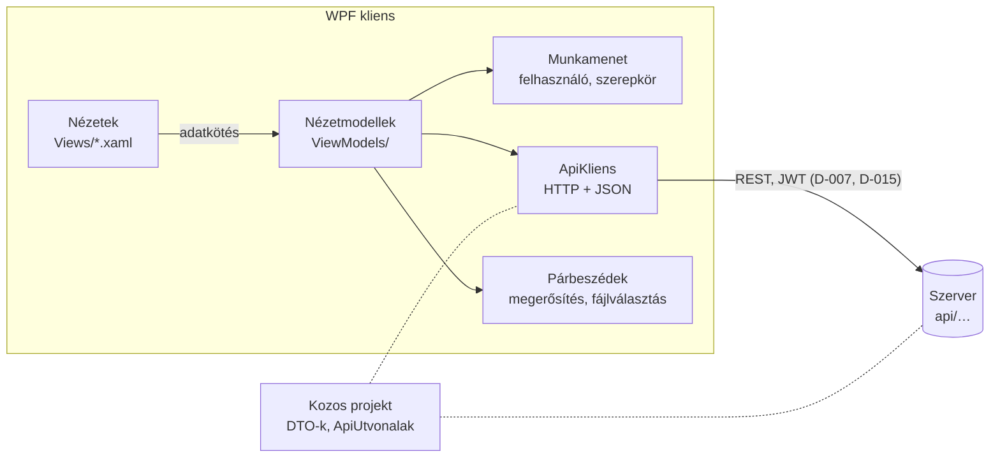
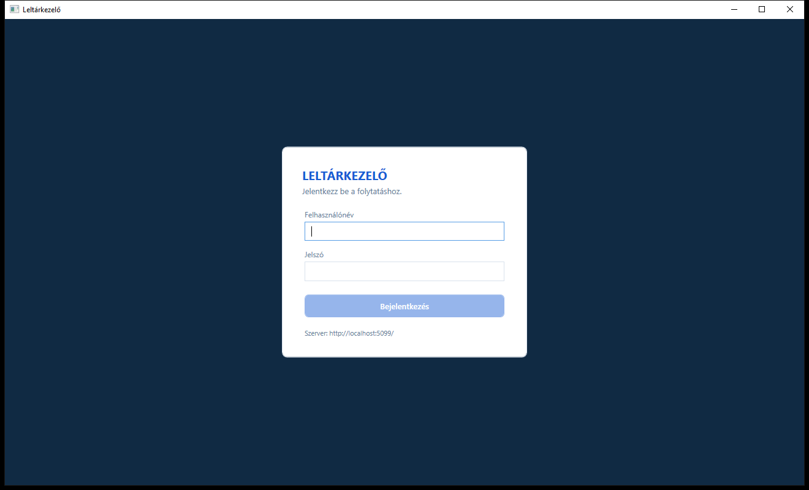
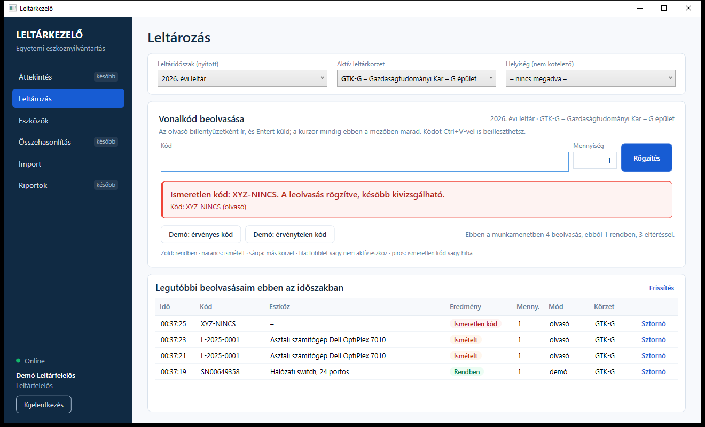
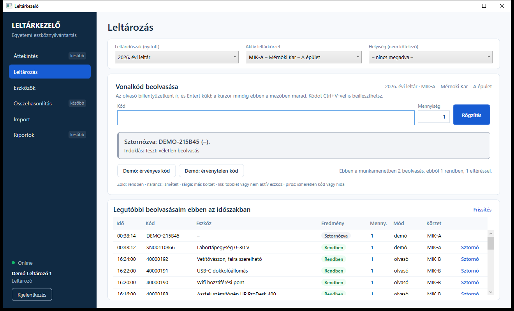
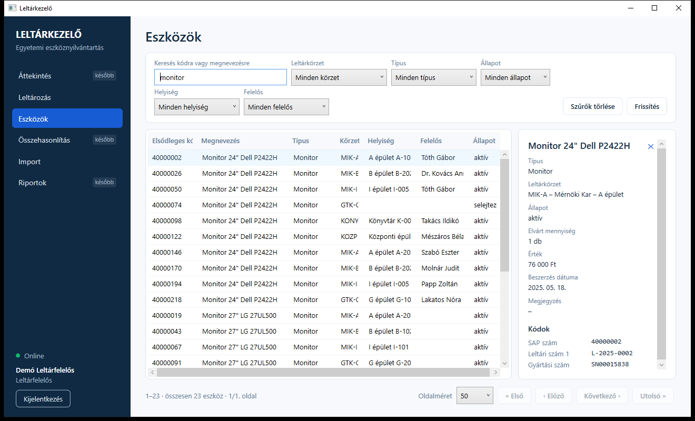
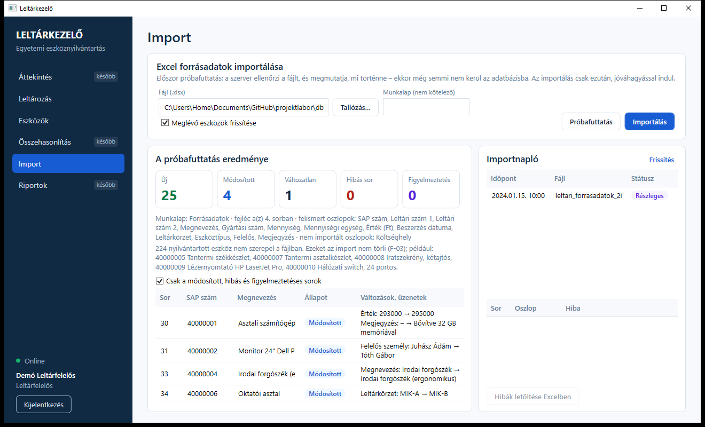
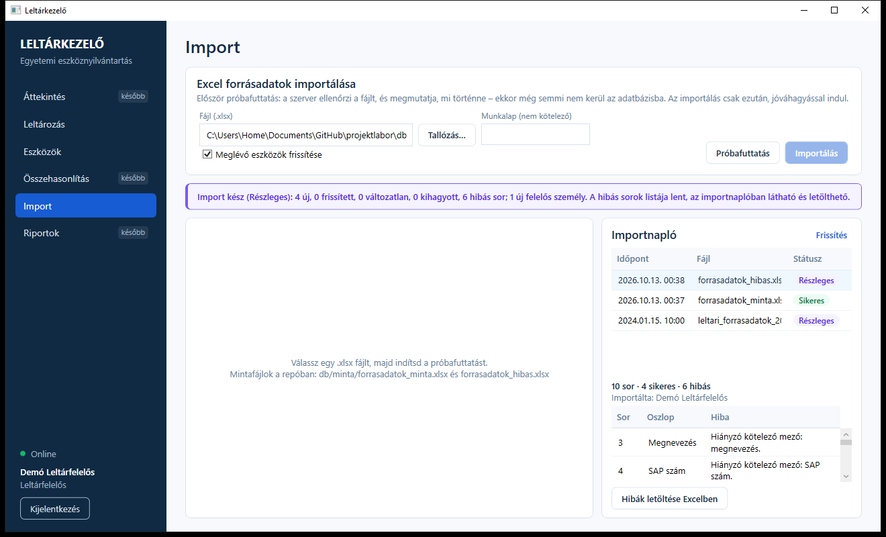
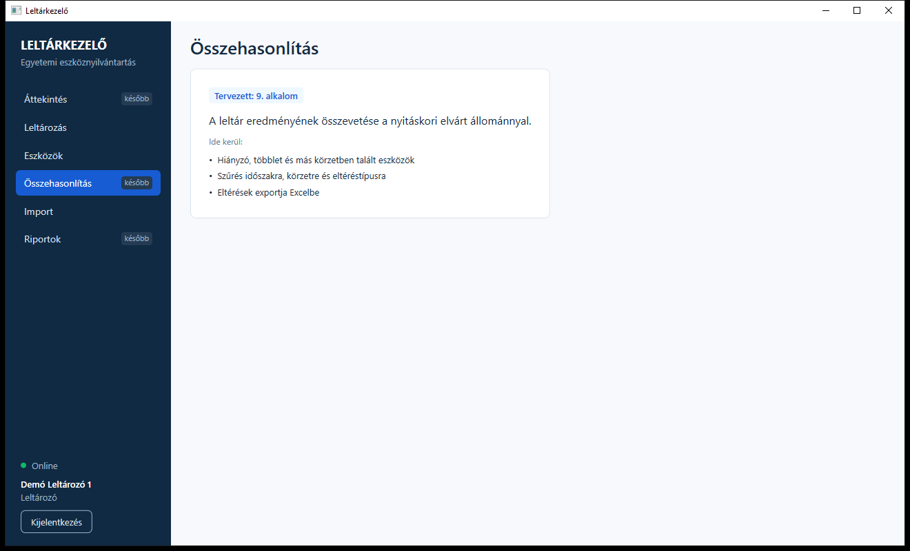

# A WPF kliens: bejelentkezés, eszközlista, import, leltározás

**Felelős:** Bárkányi Máté · **Állapot:** a 6. alkalomig esedékes kliensfeladatok elkészültek, a futó szerverrel kipróbálva

Ez a leírás a kliens 4–6. alkalomig vállalt részét mutatja be. Pótolja a 4. alkalomról elmaradt **kliens–szerver
kommunikációt** és a **GUI proof of conceptet** (`04_alkalom/03_Teendok_az_5_alkalomig.md`, P3–P4). Ezen felül
elkészült az 5. alkalom **eszközlistája és import képernyője** (7. pont), valamint a 6. alkalom **leltározó képernyője**.
A megjelenésről szóló döntés: **D-016 – saját stílusok**.

## 1. Mi készült el?

| Elvárás | Hol | Állapot |
|---|---|---|
| Bejelentkezés, token kezelése (P3, D-015) | Bejelentkező képernyő, `Munkamenet` | ✅ |
| Első működő kliens–szerver kommunikáció (4. alk.) | `ApiKliens` – minden hívás a közös projekt típusaival | ✅ |
| GUI proof of concept, stíluskönyvtár (P4, D-016) | Saját stílusok a 4. alkalmi látványterv színeivel | ✅ |
| Eszközök megjelenítése, keresés, alapszűrés (5. alk., UC-10) | *Eszközök* oldal: keresés, 5 szűrő, lapozás, részletek | ✅ |
| Import képernyő: fájlválasztás, eredmény, hibalista (5. alk.) | *Import* oldal: próbafuttatás, jóváhagyás, importnapló | ✅ |
| Leltárkörzet és -időszak kiválasztása (6. alk.) | *Leltározás* oldal, felső sáv | ✅ |
| Vonalkód beolvasása olvasóval és olvasó nélkül (6. alk., F-09) | Beolvasó mező, Ctrl+V, demókód gombokkal és billentyűkkel | ✅ |
| Érvényes és érvénytelen kód egyértelmű jelzése (6. alk., UC-06) | Színes visszajelző sáv a szerver minősítése alapján | ✅ |
| Leolvasás mentése, saját leolvasások, sztornó (6–7. alk., UC-08) | Legutóbbi beolvasások listája, sztornó indoklással | ✅ |
| Áttekintés, összehasonlítás, riportok | Menüpont „később” jelzéssel; az oldal megmutatja, mi kerül oda és mikor | ⏳ 9. és 11. alkalom |
| Kamerás beolvasás (D-009) | Előkészítve: közös beolvasási belépési pont | ⏳ 12. alkalom |

## 2. Felépítés

- **MVVM a CommunityToolkit.Mvvm csomaggal (D-014).** A nézetmodellek `[ObservableProperty]` és `[RelayCommand]`
  attribútumokat használnak, a kód többi részét a fordító generálja. A nézetek mögötti kód csak azt kezeli, amit
  adatkötéssel nem lehet megoldani: a jelszómezőt, a fókuszt és a beillesztés felismerését.
- **Függőséginjektálás.** A .NET beépített tárolója rakja össze a szolgáltatásokat (`App.xaml.cs`). Az oldalak
  nézetmodelljei minden bejelentkezéskor újra létrejönnek, így egy másik felhasználó nem látja az előző adatait.
- **Navigáció.** A főablak a kiválasztott menüpont nézetmodelljét jeleníti meg. A nézetet hozzá az `App.xaml`
  adatsablonjai választják ki. Az oldalak állapota menüváltáskor megmarad.
- **Szerverhívások (`ApiKliens`).** Az útvonalak (`ApiUtvonalak`) és a típusok a `Kozos` projektből jönnek, így a
  kliens és a szerver nem csúszhat el egymástól. A hibák Problem Details formában érkeznek (D-018). A `detail`
  üzenet kerül a képernyőre, magyarul.
- **Lejárt token.** Ha bejelentkezett állapotban 401-es válasz jön, a kliens visszalép a bejelentkező képernyőre,
  „A bejelentkezés lejárt” üzenettel.
- **A token csak a memóriában van** (D-015). A program bezárásával a munkamenet véget ér, a jelszó sehol nem tárolódik.
- **Szerverállapot.** A bal alsó sarokban látszik, hogy elérhető-e a szerver. Ezt a kliens 30 másodpercenként
  ellenőrzi (`GET /api/allapot`).

| Mappa | Tartalom |
|---|---|
| `Szolgaltatasok/` | `ApiKliens` (REST-hívások, hibakezelés), `Munkamenet` (felhasználó, jogosultságok), `Parbeszedek` |
| `ViewModels/` | `FoAblak`, `Bejelentkezes`, `Leltarozas`, `Eszkozok`, `Import`, `Kesobb` (+ közös `OldalViewModel`) |
| `Views/` | A képernyők XAML-je; `SzovegBekeroAblak` a sztornó indoklásához |
| `Stilusok/` | `Szinek.xaml` (színpaletta), `Vezerlok.xaml` (gombok, mezők, táblázat, menü, kártyák) |
| `Konverterek/` | A visszajelzés színe (`JelzesSzinKonverter`), láthatóság |

## 3. Képernyők

### 3.1 Bejelentkezés

A felhasználónév és a jelszó megadása után a kliens a `POST /api/auth/login` végpontot hívja. Hibás adatnál a
szerver üzenete jelenik meg, a jelszómező pedig sikeres belépés után kiürül. A kártya alján a szerver címe látszik,
így azonnal kiderül, ha rossz szerverre próbál csatlakozni.

A belépés után a menü minden szerepkörnek ugyanaz, de az oldalak a jogosultsági mátrix szerint viselkednek (5. pont).
A kezdőoldal leltározónak, leltárfelelősnek és adminnak a *Leltározás*, megtekintőnek az *Eszközök*.

### 3.2 Leltározás (UC-06, 6. alkalom)

1. **Időszak és körzet.** A felső sávban a nyitott leltáridőszak és az aktív körzet választható ki. Ha csak egy
   nyitott időszak van, az automatikusan kiválasztódik. Azok a körzetek, amelyekben a felhasználó nem leltározhat,
   szürkén jelennek meg, és nem választhatók (a szerver `leltarozhato` jelzése alapján). A helyiség megadása nem
   kötelező.
2. **Beolvasás.** Az olvasó billentyűzetként ír, és Entert küld. A kurzor minden beolvasás után visszakerül a
   kódmezőbe, így egymás után lehet olvasni (F-09).
   - A kód Ctrl+V-vel is beilleszthető; ilyenkor *beillesztés* beviteli módként rögzül.
   - Mennyiséges eszköznél a megszámolt darabszám a *Mennyiség* mezőbe írható (UC-07).
   - A gyors egymás utáni beolvasások sorban mennek a szerverre, így nem keverednek össze.
3. **Olvasó nélkül** (demó, UC-06 5c):
   - **Demó: érvényes kód** (**Ctrl+Shift+R**): a körzet egy még be nem olvasott eszközének kódját kéri le a
     szervertől, és be is küldi;
   - **Demó: érvénytelen kód** (**Ctrl+Shift+E**): egy egyetlen eszközhöz sem tartozó kódot küld.

   Mindkettő *demó* módként rögzül, így utólag kiszűrhető.
4. **Visszajelzés.** A szerver minősítése színes sávban jelenik meg, a szerver kész szövegével. Alatta a részletek
   állnak: a beolvasott kód és a beviteli mód, melyik kódtípus alapján azonosult az eszköz, ismételt beolvasásnál
   az első beolvasás ideje (*„már beolvasva: ma 10:42”*, UC-06 6b), mennyiséges eszköznél pedig *elvárt · beolvasva ·
   hiányzik/többlet*.
5. **Legutóbbi beolvasásaim.** A saját utolsó 20 leolvasás ebben az időszakban, a legújabb elöl. Ide a sztornózottak
   is bekerülnek, áthúzás helyett *Sztornózva* címkével.

| Minősítés (szerver) | Szín | Példa |
|---|---|---|
| `Ok` | zöld | Rendben: Asztali számítógép (1/1 db) |
| `Ismetelt` | narancs | Már beolvasva: ma 10:42 – a darabszám nem nő |
| `MasKorzet` | sárga | Az eszköz a(z) GTK-G körzetbe tartozik |
| `Tobblet`, `NemAktiv` | lila (figyelmeztetés) | Többlet: elvárt 30 db, beolvasva 32 db · Nem aktív eszköz került elő |
| `IsmeretlenKod` | piros | Ismeretlen kód: … A leolvasás rögzítve |
| hálózati vagy szerverhiba | sötétpiros | *Nem rögzült:* … (pl. lezárt időszak, nincs jogosultság) |

A színek a `06_alkalom/01_Leltarozas_szerver.md` 4. pontjában rögzített jelzéseket követik. Az ismeretlen kód és a
technikai hiba szándékosan különbözik: az előbbi rögzült leolvasás, az utóbbi nem került be. A színeken kívül mindig
szöveg is jelzi az eredményt, így a színtévesztők számára is egyértelmű.

**Sztornó (UC-08).** A lista *Sztornó* hivatkozása bekéri az indoklást, amely kötelező, legfeljebb 500 karakter.
Ezután a kliens a `POST /api/leolvasasok/{id}/sztorno` végpontot hívja, és a sor *Sztornózva* címkét kap.

### 3.3 Eszközök (UC-10, 5. alkalom)

- **Keresés** bármely kódra (SAP, leltári, gyári szám, belső vonalkód) vagy a megnevezés részletére. A lista gépelés
  közben, rövid késleltetéssel frissül; Enterre azonnal.
- **Szűrők:** leltárkörzet, típus, állapot, helyiség, felelős. A választólisták a törzsadat-végpontokról töltődnek.
  A típusok fába rendezve jelennek meg, és a főtípusra szűrés az altípusokat is hozza (a szerver így szűr).
- **Lapozás** a szerveren: 25, 50, 100 vagy 200 elem oldalanként, első, előző, következő és utolsó oldal.
- **Részletek:** egy sor kiválasztására jobbra megjelenik az eszköz minden adata és kódja. A lecserélt, inaktív kódok
  áthúzva látszanak. Az elsődleges kód cellája felett a további kódok buboréksúgóban jelennek meg.
- A láthatóságot a szerver szabja meg (leltározó és megtekintő csak a saját körzetét, illetve szervezeti egységét
  látja), a kliens ezt nem írja felül.

### 3.4 Import (5. alkalom, D-031)

1. **Fájl:** a *Tallózás…* gombbal, vagy az elérési út beillesztésével. A Windows „Elérési út másolása” által tett
   idézőjeleket a kliens levágja.
2. **Beállítások:**
   - munkalap: nem kötelező;
   - *meglévő eszközök frissítése*: kikapcsolva csak az új eszközök kerülnek be.
3. **Próbafuttatás:** semmit nem ír az adatbázisba. Megmutatja:
   - az összesítést (új, módosított, változatlan, hibás sor, figyelmeztetés);
   - a felismert és a nem importált oszlopokat;
   - a fájlban nem szereplő, de nyilvántartott eszközök számát (F-03);
   - soronként az eltéréseket: módosított sornál mezőnként *régi → új*, hibás sornál az okát.

   Alapból csak az érdekes sorok látszanak, egy jelölőnégyzettel az összes megjeleníthető.
4. **Importálás:** megerősítést kér, amely összefoglalja, mi fog történni. A szerver a végrehajtás előtt újra
   ellenőrzi a fájlt. Az eredmény egy színes sávban jelenik meg.
5. **Importnapló:** a legutóbbi 20 futás. Egy futás kiválasztásakor látszanak a hibás sorai (sor, oszlop, hiba), a
   *Hibák letöltése Excelben* gomb pedig elmenti őket (`GET /api/importok/{id}/hibak.xlsx`).

### 3.5 Később elkészülő oldalak

Az *Áttekintés*, az *Összehasonlítás* és a *Riportok* már szerepel a menüben, *később* jelzéssel. Az oldalaik
megmutatják, mi kerül oda, és az ütemterv szerint melyik alkalomra (`03_alkalom/05_Fejlesztesi_utemterv.md`), így a
terv bemutatható.

## 4. Megjelenés (D-016)

- **Saját stílusok, külső csomag nélkül.** A színek a 4. alkalmi látványtervből jönnek: sötétkék oldalsáv, kék
  kiemelőszín, világos háttér, fehér kártyák.
- **Két erőforrásfájl.** `Stilusok/Szinek.xaml` a palettát, `Stilusok/Vezerlok.xaml` a gombok (elsődleges,
  másodlagos, hivatkozás), a mezők, a táblázatok, a menü és a kártyák stílusát tartalmazza.
- **A visszajelzések színe egy helyen van** (`JelzesSzinKonverter`): halvány háttér, erős szegély és sötét szöveg,
  hogy a szöveg minden színen jól olvasható maradjon.
- **Magyar formátumok.** A dátumok és a pénzösszegek magyarul jelennek meg (`2025. 05. 18.`, `76 000 Ft`), mert a
  főablak nyelve `hu-HU`. A szerver UTC időpontjai helyi időre váltva látszanak.
- **Akadálymentesség.** A gombokon és a menüpontokon olvasható név van (UI Automation), így a felület képernyőolvasóval
  és automatizált teszttel is bejárható.

## 5. Jogosultság a kliensen

A kliens a token szerepkörei alapján rejti el vagy tiltja le azt, amit a felhasználó úgysem tehetne meg. **A tényleges
ellenőrzés mindig a szerveren történik** (D-019): ha a kliens tévedne, a szerver akkor is 403-at adna.

| Oldal | Admin | Leltárfelelős | Leltározó | Megtekintő |
|---|---|---|---|---|
| Leltározás | minden körzet | minden körzet | csak a hozzá rendelt körzetek | figyelmeztetés, nincs beolvasó |
| Eszközök | minden | minden | a saját körzetei | a saját szervezeti egysége |
| Import | ✅ | ✅ | jogosultsági üzenet | jogosultsági üzenet |

## 6. Beállítás és indítás

- **Szervercím:** a kliens a szervert a `src/Kliens/appsettings.json` `Szerver:Cim` értékén éri el. Az alapérték
  `http://localhost:5000/`, mert a csoport gépein a szerver ezen a porton figyel.
- **Saját cím:** ha a saját géped más címet használ, hozd létre a `src/Kliens/appsettings.Local.json` fájlt ugyanilyen
  szerkezettel. Ez nem kerül a repóba (`.gitignore`).
- **Visual Studio:** a megoldás tulajdonságai között a *Multiple startup projects* opcióval egyszerre indul a
  `LeltarKezelo.Szerver` és a `Leltarkezelo.Client` (`LeltarKezelo.slnLaunch.user`).
- **Parancssor:** `dotnet run --project src/Szerver`, majd külön terminálban `dotnet run --project src/Kliens`.
- **Belépés:** a demóadatokkal (`db/demoadatok.sql`) a `leltarfelelos`, `leltarozo1` vagy `megtekinto` felhasználóval.
  A közös demójelszó a szkript fejlécében van.
- **Hibanapló:** a váratlan hibákat a kliens üzenetablakban jelzi, és a program mappájába, a `hibanaplo.txt`-be írja.

## 7. Ellenőrzés

A klienst a futó szerverrel, egy ideiglenes SQL Server-adatbázison próbáltuk ki, amely migrációval és demóadatokkal
készült, a próba után pedig törlődött. A felületet UI Automation szkript vezérelte, a képernyőképek is így készültek.

| Forgatókönyv | Eredmény |
|---|---|
| Bejelentkezés leltárfelelősként, leltározóként, megtekintőként | ✅ a kezdőoldal és a menü a szerepkör szerint |
| Demó érvényes kód → ugyanaz a kód még egyszer → ismeretlen kód | ✅ zöld → narancs („már beolvasva”) → piros, a lista frissül |
| Leltározó: a körzetválasztó a hozzá rendelt körzettel (MIK-A) indul, demókód beolvasása ott | ✅ rendben, a saját listájában megjelenik |
| Sztornó indoklással | ✅ a sor *Sztornózva* címkét kap |
| Eszközök: keresés („monitor”), sor kiválasztása, részletek | ✅ a találatok lapozva, a részletekben minden adat és kód |
| Import: próbafuttatás a helyes mintafájllal | ✅ 25 új, 4 módosított (mezőnkénti különbséggel), 1 változatlan |
| Import végrehajtása megerősítéssel, majd a hibás mintafájl | ✅ *Sikeres*, illetve *Részleges* futás a naplóban, 6 hibás sor |
| Megtekintő: Leltározás és Import oldal | ✅ csak a jogosultsági üzenet látszik |

**A próba közben talált és javított hibák:**
- Az import oldal egyik erőforrásneve ütközött a közös stílussal, ezért az oldal nem töltődött be.
- Az eszközlista oszlopai a részletpanel mellett összecsúsztak.

**Nincs automatikus kliensteszt** (a csoport döntése szerint egyelőre kézi kipróbálás). A kliens a szerver tesztekkel
lefedett végpontjait hívja.

## 8. Ismert korlátok és következő lépések

- **Kamerás beolvasás (D-009, 12. alkalom).** Minden beolvasás a `LeltarozasViewModel.BeolvasasAsync(kod, mod)`
  belépési ponton megy át. A kamera ezt fogja hívni `Kamera` móddal, így a minősítés, a visszajelzés és a lista
  változtatás nélkül működik vele is.
- **Leltáridőszak kezelése.** A leltárfelelős egyelőre Swaggerből hozhat létre, nyithat és zárhat le időszakot; a
  kliensen ennek nincs képernyője.
- **Oszlop-hozzárendelés az importban.** A szerver fogadja (`oszlopok`), de a kliensen még nincs hozzá képernyő. A
  valódi forrásfájl megérkezése után lesz rá szükség, ha a fejlécnevek nem ismerhetők fel automatikusan.
- **Egyéb, későbbi alkalmakra eső funkciók:** eszköz felvitele és szerkesztése (UC-11–13, 11. alkalom), áttekintés,
  összehasonlítás, riportok.
- **Hangjelzés beolvasáskor.** Zajos környezetben hasznos lehet, a csoport dönt róla.
