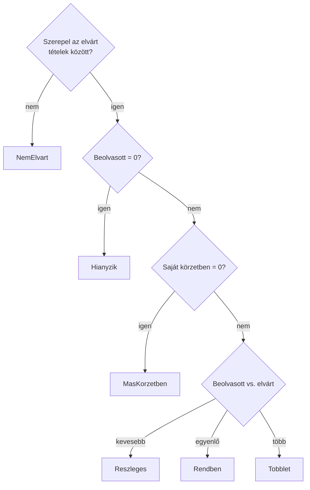

# Mennyiségek és eltérő körzet – szerveroldal

**Felelős:** Horváth Máté · **Állapot:** a 7. alkalomra elkészült, tesztelt változat

A 7. alkalom elvárása: darabszámok kezelése, az elvárt és a tényleges mennyiség összevetése, a hiány és a többlet
kimutatása, valamint a másik körzetben előkerült eszközök rögzítése és jelzése. A leolvasás szintjén ezek egy része
már a 6. alkalomra elkészült (minősítés: `TOBBLET`, `MAS_KORZET`, `ISMETELT`); most a **tétel- és körzetszintű
összesítés** került mellé, amelyből a leltározó képernyő (Bárkányi Máté) és a 9. alkalom összehasonlító nézetei dolgoznak.

## 1. Mi készült el?

| Elvárás (kiírás, 7. alkalom) | Megvalósítás |
|---|---|
| Darabszámok | Eszközönként az elvárt és a beolvasott mennyiség, a saját körzetben talált rész, hiány és többlet |
| Elvárt vs. tényleges | `GET /api/leltaridoszakok/{id}/tetelek` – tételállapot: `Hianyzik`, `Reszleges`, `Rendben`, `Tobblet`, `MasKorzetben`, `NemElvart` |
| Hiány / többlet | Körzetenkénti összesítő: `GET /api/leltaridoszakok/{id}/osszesites` (darabok, készültség) |
| Másik körzet rögzítése és jelzése | A tétel felsorolja, mely körzetekben került elő; a körzetösszesítő mindkét oldalon jelzi (hiányzó helyett `MasKorzetben`, illetve „más körzetből ide került”) |
| *(a 6. alkalom nyitott pontjai)* | Sztornó utáni ismétlés, egyidejű beolvasás, a pillanatkép utólagos bővítése (`POST .../elvart-tetelek`) |

## 2. A darabszám számítása (D-036)

A darabszám nem a leolvasáskor eltárolt érték, hanem **mindig a nem sztornózott leolvasásokból számolódik**:

| Eszköz | Beolvasott mennyiség | Saját körzetben |
|---|---|---|
| Egyedi (elvárt = 1) | a leolvasások mennyiségeinek **maximuma**; az `ISMETELT` sor legfeljebb 1 darabot jelent (D-041) | ugyanez, csak az elvárt körzet leolvasásaiból |
| Mennyiséges (elvárt > 1) | a nem `ISMETELT` leolvasások mennyiségeinek **összege** | ugyanez az elvárt körzetre szűrve |

Az egyedi eszköznél a maximum két ismert korlátot old fel a 6. alkalomból:

- **Sztornó utáni ismétlés:** ha az első (számított) leolvasást sztornózzák, a megmaradó `ISMETELT` sor is jelzi,
  hogy az eszköz megvan – újrabeolvasás nélkül.
- **Egyidejű beolvasás:** ha két leltározó egyszerre olvassa be ugyanazt az eszközt és mindkettő `OK`-t kap, a
  darabszám akkor is 1 marad. Zárolásra így nincs szükség.

Egy egyedi eszköz 2-es mennyiséggel beolvasva továbbra is többletként jelenik meg (a leolvasás `TOBBLET` minősítésű).

Nem elvárt tételnél a törzsadat darabszáma dönti el, hogy az eszköz egyedi vagy mennyiséges (D-041).

## 3. A tétel állapota



- A **más körzet** megelőzi a többi állapotot, ha a saját körzetben semmi nem került elő – összhangban a D-027-tel
  (az eltérő hely a fontosabb információ). Ha egy mennyiséges eszköz részben a saját, részben más körzetben van, a
  darabszám alapján minősül, a `talaltKorzetek` mező viszont felsorolja az összes körzetet.
- A `NemElvart` tétel a nyitás után felvett, de beolvasott eszköz. Az elvárt tételek közé a leltárfelelős veheti fel
  (5. pont), ezután rendes tételként minősül.
- A hiány `max(0, elvárt − beolvasott)`, a többlet `max(0, beolvasott − elvárt)`.

## 4. Végpontok

| Metódus és útvonal | Jogosultság | Leírás |
|---|---|---|
| `GET /api/leltaridoszakok/{id}/osszesites` | bejelentkezett | Körzetenkénti összesítő a látható körzetekre |
| `GET /api/leltaridoszakok/{id}/tetelek?leltarkorzetId=&allapot=&csakElteresek=&oldal=&oldalMeret=` | bejelentkezett | Lapozott tétellista; rendezés: állapot, majd megnevezés |
| `POST /api/leltaridoszakok/{id}/elvart-tetelek` `{ "eszkozId": 42 }` | admin, leltárfelelős | Utólagos felvétel (`Utolagos` felvételi ok, D-003) |

A körzetösszesítő egy eleme:

```json
{ "leltarkorzetId": 2, "kod": "GTK-01", "nev": "Gazdaságtudományi Kar",
  "elvartTetelek": 1, "rendben": 1, "reszleges": 0, "hianyzik": 0, "tobblet": 0, "masKorzetben": 0,
  "masKorzetbolIdeKerult": 1, "nemElvart": 0, "ismeretlenKodok": 1,
  "elvartMennyiseg": 1, "beolvasottMennyiseg": 1, "keszultseg": 1.0 }
```

A **láthatóság** a meglévő szabályt követi (`KorzetJogosultsag.LathatoKorzetekAsync`): a leltározó a hozzárendelt
körzeteit, a megtekintő a szervezeti egysége körzeteit látja, az admin és a leltárfelelős mindent. Egy tétel akkor
látható, ha az elvárt körzete **vagy** valamelyik körzet, ahol előkerült, látható – így a leltározó a hozzá „átkerült”
idegen eszközt is látja.

Hibás esetek: nem létező időszak 404; ismeretlen `allapot` 400; utólagos felvételnél nem létező eszköz 404,
megszűnt eszköz 400, már felvett eszköz és nem nyitott időszak 409, leltározó és megtekintő 403.

## 5. Utólagos bővítés

A pillanatkép a nyitáskor rögzül (D-030), így a nyitás után importált vagy felvett eszköz nem elvárt tétel. A
leltárfelelős a `NemElvart` tételek közül egyenként felveheti őket; az elvárt körzet és mennyiség ilyenkor az eszköz
aktuális törzsadatából jön. A beolvasás minősítése ezt már a következő leolvasásnál figyelembe veszi.

## 6. Tesztek

`tests/Szerver.Tesztek/OsszesitesTesztek.cs` – 20 új eset, a teljes csomag 152 tesztje zöld:

| Terület | Esetek |
|---|---|
| Számítás (egységteszt) | két `OK` egyedi eszközre = 1 db; sztornó után megmaradt ismétlés; mennyiség körzetenként |
| Tételállapot (egységteszt) | mind a hat állapot, a részben más körzetben talált többlet is |
| Integráció | friss időszak (minden hiányzik); hiány, többlet, más körzet egy leltárban; részleges mennyiség sztornóval; körzetösszesítő ismeretlen kóddal és átkerült eszközzel; szűrés állapotra, körzetre, eltérésre; leltározó láthatósága; 404 |
| Utólagos felvétel (külön adatbázison) | `NemElvart` → felvétel → `Rendben`, ismételt felvétel 409; megszűnt eszköz 400, nem létező 404, leltározó 403, lezárt időszak 409 |

## 7. Ismert korlátok és a következő alkalmak

| Téma | Állapot | Terv |
|---|---|---|
| Teljesítmény | Az összesítés a memóriában készül egy időszak összes tételéből (néhány ezer sor, egy lekérdezés táblánként) | Ha lassú, SQL-oldali csoportosítás vagy lezáráskor eltárolt eredmény |
| Összehasonlító nézetek | A tétellista már szűrhető állapotra | 9. alkalom: időszakok összevetése, export (B, A) |
| Helyiség, kiegészítők | Változatlan | 8. alkalom (C, A) |
