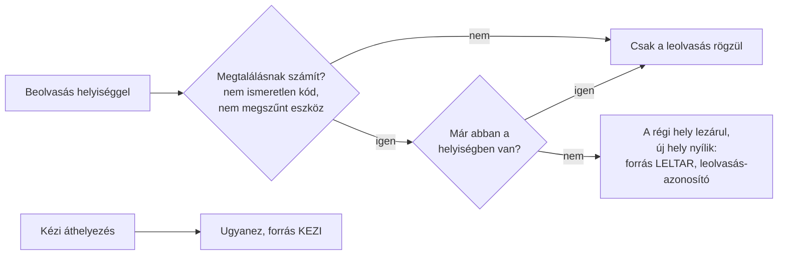

# Helyszín, felelős, eszköztípus és kiegészítők – szerveroldal

**Felelős:** Kiss Barnabás · **Állapot:** a szerveroldal és a tesztek elkészültek, SQL Serveren kipróbálva; a kliens képernyői (Bárkányi Máté) még hiányoznak

A 8. alkalom elvárása, hogy a rendszer már ne csak a forrásadatokat kezelje, hanem a leltározás során keletkező
adatokat is: helyiségeket, az eszköz helyét, felelősét és típusát. Ide tartozik a kiegészítők ellenőrzése is (M17),
amelyet a 6. alkalom erre az alkalomra halasztott. A táblák az adatmodell v1 óta megvannak, ezért **sémaváltozás és új
migráció nem kellett**. Döntések: D-042–D-044 (javasolt).

## 1. Mi készült el?

| Elvárás (kiírás, 8. alkalom) | Megvalósítás |
|---|---|
| Helyiségek/szobák létrehozása | `POST`, `PUT /api/helyisegek`; törlés helyett inaktiválás |
| Több eszköz egymás utáni beolvasása egy helyiségben | A beolvasás eddig is fogadta a helyiséget; most az eszköz **helytörténetébe** is bekerül |
| A helyszínhez kapcsolódó adatok mentése | `Elhelyezes` sor a leolvasás azonosítójával; a sztornó visszaállítja az előző helyet |
| Felelős személy hozzárendelése | `PUT /api/eszkozok/{id}/felelos`, a felelős személyek kezelése; a történet megmarad |
| Egyedi eszköztípusok kezelése | `POST`, `PUT /api/eszkoztipusok` (hierarchia), `PUT /api/eszkozok/{id}/tipus` |
| Keresés és szűrés az új adatokra | Az eszközlista helyiségre, felelősre és típusra szűr (5. alkalom óta); most már változhatnak is ezek az adatok |
| Kiegészítők (kiírás 7. pont) | Feltételezett és közvetlen ellenőrzés a leltárban, a kapcsolat felvétele és lezárása |

## 2. Végpontok

A módosító végpontok **Admin** és **Leltárfelelős** szerepkörrel érhetők el (jogosultsági mátrix: törzsadatok, eszköz
módosítása). A lekérdezéseket minden bejelentkezett felhasználó elérheti a számára látható körzetekben.

| Metódus és útvonal | Leírás |
|---|---|
| `GET /api/helyisegek/kezeles` | Minden helyiség (az inaktívak is), a bennük lévő eszközök számával |
| `POST /api/helyisegek`, `PUT /api/helyisegek/{id}` | Helyiség felvétele, módosítása, inaktiválása |
| `GET /api/eszkoztipusok/kezeles` | Minden típus az eszközök és az aktív altípusok számával |
| `POST /api/eszkoztipusok`, `PUT /api/eszkoztipusok/{id}` | Típus felvétele, átnevezése, átsorolása, inaktiválása |
| `GET /api/felelosok/kezeles` | Minden felelős személy az azonosítóval, e-mail-címmel és az eszközök számával |
| `POST /api/felelosok`, `PUT /api/felelosok/{id}` | Felelős személy felvétele, módosítása, inaktiválása |
| `GET /api/eszkozok/{id}/hozzarendelesek` | Az eszköz aktuális típusa, helye, felelőse és állapota |
| `PUT /api/eszkozok/{id}/hely` `{ "helyisegId": 12 }` | Kézi áthelyezés; `null` esetén a hely ismeretlenné válik |
| `PUT /api/eszkozok/{id}/felelos` `{ "felelosId": 3 }` | Felelős hozzárendelése vagy cseréje; `null` esetén megszűnik |
| `PUT /api/eszkozok/{id}/tipus` `{ "eszkozTipusId": 11 }` | Típus hozzárendelése |
| `GET /api/eszkozok/{id}/kiegeszitok?leltarIdoszakId=&lezartakkal=` | Az eszköz kiegészítői, a megadott leltárban az ellenőrzés módjával |
| `POST /api/eszkozok/{id}/kiegeszitok` | Kiegészítő felvétele: saját kódú eszköz (`kiegeszitoEszkozId`) vagy leírt tartozék (`leiras`, `mennyiseg`) |
| `POST /api/kiegeszitok/{id}/lezaras` | A kapcsolat lezárása (nem törlődik) |
| `GET /api/leolvasasok/{id}/kiegeszitok` | Egy leolvasáshoz tartozó kiegészítők és ellenőrzésük (leltározó is) |
| `PUT /api/leolvasasok/{id}/kiegeszitok/{kiegeszitoId}` `{ "kozvetlen": true }` | Kód nélküli tartozék kézi megerősítése (leltározó is, a saját leolvasásánál) |

A meglévő `GET /api/helyisegek`, `/api/eszkoztipusok` és `/api/felelosok` listák változatlanok: csak az aktív elemeket
adják vissza. Hibák: hiányzó vagy túl hosszú mező 400, nem létező elem 404, ütközés vagy használatban lévő elem
inaktiválása 409, jogosultság hiánya 403 (Problem Details, magyar üzenettel).

## 3. Szabályok

### 3.1 Törzsadatok (D-043)

- **Helyiség:** az épület és a szobaszám együtt egyedi, kis- és nagybetűtől függetlenül (F-22). A vonalkód egyedi, és
  nem egyezhet egy eszköz aktív kódjával, hogy a 12. alkalom helyiségcímkéi egyértelműek legyenek.
- **Eszköztípus:** a név ékezettől és írásmódtól függetlenül egyedi, mert az import név alapján keres típust (D-034).
  Egy típus nem sorolható önmaga vagy a saját altípusa alá.
- **Felelős személy:** az azonosító egyedi; az azonos nevű személyeket ez különbözteti meg.
- **Nincs törlés, csak inaktiválás**, és csak akkor, ha az elemet már semmi nem használja: a helyiségben nincs eszköz,
  a típusnak nincs eszköze és aktív altípusa, a felelős nevén nincs eszköz. A hibaüzenet megmondja, hány eszköz érintett.

### 3.2 Az eszköz helye (F-23, D-042)

- A helyiség megadása a beolvasásnál továbbra sem kötelező; helyiség nélküli beolvasás nem változtat helyet.
- A más körzetben vagy ismételten beolvasott eszköz helye is frissül, mert az eszközt ott látták.
- **Mennyiséges eszköznél** az aktuális hely az utolsó beolvasás helyisége; hogy melyik helyiségben hány darabot
  számoltak, azt az eszköz története mutatja leltáranként (`helyisegek`), a leolvasásokból számolva.
- **Sztornó:** ha az eszköz még azon a helyen áll, ahová a sztornózott leolvasás tette, visszakerül az előző helyére.
  Sor nem törlődik: a történetben mindhárom lépés látszik.
- Megszűnt állapotú eszköznek nem adható hely és felelős.

### 3.3 Felelős (F-24)

Egy eszköznek egyszerre egy felelőse van. Váltáskor a régi hozzárendelés lezárul, az új ugyanazzal az időponttal nyílik.
Ha a kért felelős már az aktuális, nem keletkezik új sor. A történet megmutatja, ki rögzítette a váltást.

### 3.4 Kiegészítők (F-19–F-21, D-044)

| Helyzet | Eredmény |
|---|---|
| A fő eszközt beolvassák | Minden aktív kiegészítője **feltételezett** sort kap a leolvasáshoz |
| A kiegészítő saját kódját is beolvassák (előbb vagy később) | A sor **közvetlen** lesz |
| A kiegészítő leolvasását sztornózzák, és nem marad másik | Visszaáll **feltételezettre** |
| Kód nélküli tartozék (pl. billentyűzet és egér) | A leltározó a saját leolvasásánál kézzel megerősítheti: **közvetlen** |
| A fő eszköz leolvasását sztornózzák | A kiegészítők abban a leltárban **nincsenek ellenőrizve** |
| Lezárt leltár | Az ellenőrzés már nem módosítható (409) |

Egy saját kódú eszköz egyszerre csak egy fő eszköz kiegészítője lehet (F-21), két eszköz nem lehet egymás kiegészítője,
megszűnt eszköz nem vehető fel. A kapcsolat nem törölhető, csak lezárható, így a korábbi leltárak ellenőrzései
értelmezhetők maradnak.

## 4. Megvalósítás

| Rész | Hol |
|---|---|
| Közös típusok | `src/Kozos/Torzsadatok/TorzsadatKezeles.cs`, `Eszkozok/EszkozKezeles.cs`, `Leltar/KiegeszitoAdatok.cs`, `ApiUtvonalak.cs` |
| Törzsadatok kezelése | `src/Szerver/Szolgaltatasok/TorzsadatKezelesSzolgaltatas.cs`, `Controllers/TorzsadatKezelesController.cs` |
| Hely, felelős, típus | `.../EszkozKezelesSzolgaltatas.cs`, `Controllers/EszkozKezelesController.cs` |
| Hely és kiegészítők a beolvasásból | `.../LeolvasasKovetes.cs` |
| Kiegészítők | `.../KiegeszitoSzolgaltatas.cs`, `Controllers/KiegeszitokController.cs` |

**Mások fájljait érintő változás (átnézendő):** Horváth Máté `BeolvasasSzolgaltatas`-ába két hívás került
(`LeolvasasKovetes.BeolvasaskorAsync` a mentés előtt, `SztornokorAsync` a sztornónál), a `Program.cs`-be pedig az új
szolgáltatások regisztrációja. A beolvasás és a sztornó továbbra is egyetlen mentés, így a hely és a kiegészítők sorai
a leolvasással együtt, atomian íródnak. A meglévő tesztjei változtatás nélkül zöldek.

Az érvényességi időszak vége az adatbázisban mindig későbbi a kezdeténél (CHECK). Hogy két gyors egymás utáni művelet
se ütközzön ezzel, az időpontok ezredmásodpercre kerekítve, legalább egy ezredmásodperc különbséggel íródnak.

## 5. Tesztek

| Tesztosztály | Teszt | Mit ellenőriz |
|---|---|---|
| `TorzsadatKezelesTesztek` | 15 | Helyiség, típus, felelős felvétele és módosítása; egyediség; inaktiválás csak használaton kívül; jogosultság |
| `EszkozHozzarendelesTesztek` | 6 | Felelősváltás és kézi áthelyezés történettel, típus, hibás cél, megszűnt eszköz, láthatóság |
| `HelyKovetesTesztek` | 5 | Hely a beolvasásból, sztornó, ugyanaz a helyiség, mennyiséges megoszlás, más körzet, megszűnt eszköz |
| `KiegeszitoTesztek` | 7 | Feltételezett és közvetlen ellenőrzés, sztornó, kézi megerősítés, lezárt leltár, kapcsolat felvétele és lezárása |
| `SqlServerTortenetTesztek` | 1 | Mindez valódi SQL Serveren: szűrt egyedi indexek, CHECK megszorítások, utána az ellenőrző szkript |

Az ellenőrző szkript (`db/ellenorzes.sql`) harmadik része öt új következetességi ellenőrzést kapott (összesen 30 pont):
megszűnt eszköznek nincs aktuális helye és felelőse; az eszköz állapota egyezik az utolsó állapotváltozással; a
leltárból származó hely leolvasása ugyanarra az eszközre és helyiségre szól; a kiegészítő ellenőrzése a fő eszköz
leolvasásához tartozik; a leltárban beolvasott kiegészítő nem maradt feltételezett. A demóadatok mind az ötnek megfelelnek.

## 6. Nyitott pontok

- **Kliens (Bárkányi Máté):** helyiségek, típusok és felelősök kezelőképernyője; áthelyezés és felelősváltás az
  eszköz részleteinél; a kiegészítők megjelenítése és megerősítése a leltározó képernyőn. A végpontok ehhez készen állnak.
- **A leolvasásnapló szűrése helyiségre** a `BeolvasasSzolgaltatas` listázásában lenne (Horváth Máté).
- **Megszűnt eszköz kiegészítő-kapcsolatai** nem zárulnak le automatikusan; a leltárfelelős zárja le őket.
- **A valódi forráslisták** *Gyártási szám* oszlopában helyiségkódnak látszó értékek vannak. Ha a csoport megerősíti,
  az import ezekből helyiséget és kezdő helyet is felvehetne; erről még nincs döntés.
- **A D-042–D-044 döntések „javasolt” állapotúak**, a csoport jóváhagyására várnak.
